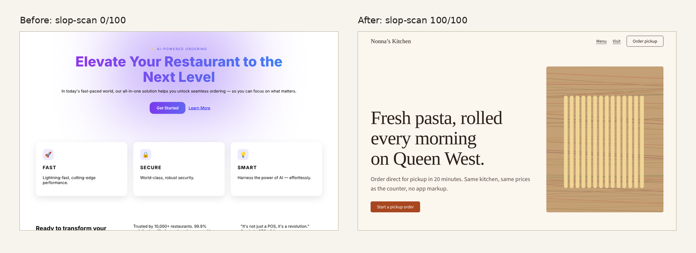

# No Slop Web

**A Claude skill for websites that look designed, not generated.**

Every AI-built site has the same face: a purple gradient, Inter, a centered headline over two buttons, three feature cards with emoji icons, and copy that promises to "elevate" something. No Slop Web is a complete playbook plus a scanner that removes those defaults and replaces them with deliberate, classy decisions about type, color, layout, motion and copy.

It distils what I learned building the full UI and UX of **Platepoint**, a direct-ordering platform for restaurants, after working through the best open source design skills, UX references and design talks available (credited below).



## What you get

- **A 7-step workflow** that goes brief, direction, tokens, build, slop scan, polish gate, ship. Your agent can't skip straight to code.
- **A slop catalogue** of more than 60 AI tells across color, type, layout, copy, icons, motion and code, each with the fix.
- **Eight design directions** (Editorial, Swiss, Quiet Luxury, Warm Craft, Technical Mono, Bold Brutal, Soft Modern, Monochrome Gallery), each a complete set of type, palette, radius, motion and a signature move.
- **Playbooks** for typography, color, layout, copy, imagery, motion, Laws of UX and WCAG 2.2 AA accessibility.
- **`slop-scan`**, a zero-dependency Node scanner that finds the tells in your code and gives you `file:line` findings and a 0 to 100 score. Works in CI.
- **A 78-point polish gate** to go through before launch.
- **Templates** (`tokens.css` with a fluid type scale and dark mode, and a `DESIGN.md` design record) plus a sloppy page and its fixed version for calibration.

## Install

**Claude Code** (personal skills):

```bash
git clone https://github.com/ambergargrish-ca/no-slop-web ~/.claude/skills/no-slop-web
```

Or per project: clone into `.claude/skills/no-slop-web` inside your repo.

**Claude.ai / Claude desktop:** download the repo as a zip and upload it under Settings > Capabilities > Skills.

**Other agents (Cursor, Codex, Windsurf):** point your agent at `SKILL.md`, or paste it into your rules file. The references are plain markdown.

## Use

Just ask:

> Build a landing page for my bakery. Use no-slop-web.

> This page looks AI-made. Run no-slop-web and fix it.

> Audit ./site with no-slop-web before we launch.

### Run the scanner yourself

```bash
node scripts/slop-scan.mjs ./your-site
node scripts/slop-scan.mjs ./your-site --json            # machine-readable
node scripts/slop-scan.mjs ./your-site --min-score=90    # fail CI below 90
node scripts/slop-scan.mjs ./your-site --ignore=legacy,docs
```

Silence a single line with a `slop-scan-ignore` comment. The scanner exits with code 1 on any high finding, so it can gate a pull request.

Try it on the examples:

```bash
node scripts/slop-scan.mjs examples/sloppy   # Score: 0/100 (full slop)
node scripts/slop-scan.mjs examples/clean    # Score: 100/100 (classy)
```

### What the scanner catches

| Area | Examples |
|---|---|
| Copy | em dashes, "elevate / unlock / seamless", "in today's fast-paced world", lorem ipsum, invented proof, question headlines, vague CTAs |
| Color | purple to blue gradients, gradient text, raw Tailwind violet and indigo, glow blobs, pure black |
| Type | default-only fonts, overused letter-spaced eyebrows |
| Icons | emoji as icons, sparkles for AI |
| Layout | three-card grids, soft-SaaS radius everywhere, shadows on everything |
| Motion | missing reduced-motion support, infinite loops, slow UI transitions, scroll-fade on every block, typewriter text |
| Accessibility and craft | missing alt, removed focus outlines, disabled zoom, clickable divs, `href="#"`, missing lang, title, description or OG image |

The scanner checks code. Taste, rhythm and composition are covered by the squint test and the polish gate, because no regex can judge them.

## Repository layout

```
SKILL.md                    the workflow and non-negotiables (agent entry point)
references/
  slop-catalog.md           every tell, why it reads as AI, what to do instead
  directions.md             eight complete design directions
  typography.md  color.md  layout.md  copy.md
  imagery.md  motion.md  ux-laws.md  accessibility.md
  interaction-details.md    10 small behaviours that make a page feel finished
  mobile-details.md         10 phone and tablet details (zoom, keyboards, hover, scroll)
  polish-checklist.md       78-point pre-launch gate
  credits.md
scripts/slop-scan.mjs       the scanner
templates/                  tokens.css, DESIGN.md
examples/                   sloppy/ and clean/ versions of the same page
```

## Principles

1. AI slop is what you get when nobody made a decision. Make every decision on purpose.
2. Pick one direction and commit to it.
3. Use tokens before components, and keep magic numbers out.
4. Write the copy before the layout.
5. Never invent proof.
6. Accessibility is part of the design from the start, not a final pass.
7. The user's existing brand beats this skill's taste.

## Credits

Built by **Amber Gargrish**, Senior AI Program Manager and builder ([gargrish.com](https://gargrish.com)), from the Platepoint build.

This skill stands on the work of others. All text is original, but the thinking was shaped by:
[Hallmark](https://github.com/Nutlope/hallmark) (Nutlope),
[Taste Skill](https://github.com/Leonxlnx/taste-skill) (Leonxlnx),
[Impeccable](https://github.com/pbakaus/impeccable) (Paul Bakaus),
[UI UX Pro Max](https://github.com/nextlevelbuilder/ui-ux-pro-max-skill) (nextlevelbuilder),
[Web Interface Guidelines](https://github.com/vercel-labs/web-interface-guidelines) (Vercel),
[Design Motion Principles](https://github.com/kylezantos/design-motion-principles) (Kyle Zantos),
[Laws of UX](https://lawsofux.com) (Jon Yablonski),
Refactoring UI (Adam Wathan and Steve Schoger),
Practical Typography (Matthew Butterick),
and [Utopia](https://utopia.fyi). Full notes in [`references/credits.md`](references/credits.md).

### Companion skills

- [zero-to-live](https://github.com/ambergargrish-ca/zero-to-live): end-to-end web development, from idea to deployed site
- [brand-kit-builder](https://github.com/ambergargrish-ca/brand-kit-builder): build the brand before you build the site
- [kitchen-pos-blueprint](https://github.com/ambergargrish-ca/kitchen-pos-blueprint): build a production restaurant POS

## Cite

If this skill helped you ship something, a star helps others find it. If you adapt it, please credit it (GitHub shows a "Cite this repository" button from `CITATION.cff`):

> Gargrish, A. (2026). *No Slop Web: a Claude skill for websites that look designed, not generated.* https://github.com/ambergargrish-ca/no-slop-web

## Contributing

Found a new AI tell? Open an issue or a pull request with: the tell, why it reads as generated, the fix, and (if it can be detected in code) a scanner rule with a test line in `examples/sloppy`.

## License

MIT
